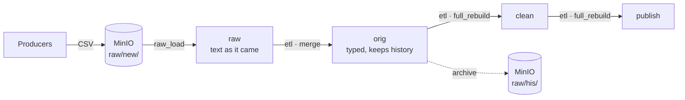

<div align="center">

# Omnis

**A self-hosted data engine: drop raw files in, describe your tables and SQL, and get them loaded, typed and
published on a schedule.**

[](https://airflow.apache.org/)
[](https://www.postgresql.org/)
[](https://min.io/)
[](https://docs.docker.com/compose/)
[](https://www.python.org/)
[](#raspberry-pi)
[](LICENSE)

[What it is](#what-it-is) · [Quickstart](#quickstart) · [Going further](#going-further)

</div>

---

## What it is

Omnis is a small data platform you run on your own machine, from a laptop to a Raspberry Pi. Producers drop CSV
files into a bucket; Omnis loads them into PostgreSQL, types and cleans them with SQL, and publishes tables ready to
query from any SQL client or BI tool, every day.

It is a **generic engine**: a data flow is a folder of plain files (a task graph, task declarations, table
definitions and SQL queries), and the engine turns it into an Airflow DAG. Adding or changing a flow needs no engine
code.



- **All processing is SQL**, in the warehouse: each transformation is one `SELECT`, written by the engine with a full
  rebuild or a merge by key.
- **Raw files are loaded once**: they are archived only after their data is safely in `orig`.
- **Failures don't go unnoticed**: a failed run e-mails you, and its flow can pause itself until you fix it.
- **Monthly backups** of the warehouse and of the raw files, out of the box.

The repo ships one flow, `health` (gym series, running sessions and muscular fatigue), as a working example.

## Quickstart

These steps take a machine with nothing installed but Docker to a running Omnis, with your own logins, a first flow
loaded and its backups kept safe. Follow them in order: some settings are only read on the very first start.

### Before you start

- [Docker](https://docs.docker.com/get-docker/) with Compose v2, and at least 4 GB of memory, 2 CPUs and 10 GB of disk
  for it (`airflow-init` warns on start if it has less).
- Free ports on the machine: `5432` (warehouse), `8080` (Airflow), `9000` and `9001` (MinIO). Any of them can be
  changed in `.env`.
- On a **Raspberry Pi**, read [Raspberry Pi](#raspberry-pi) first: it needs a kernel setting, and every
  `docker compose` command below runs with its mode file instead.

### 1. Clone the repo and configure it

```bash
git clone https://github.com/JuanDiegoBarrado/Omnis.git
cd Omnis
cp .env.example .env
```

Edit `.env` (it is gitignored, so your passwords stay on your machine). Every variable is described in
[Configuration](#configuration); these are the ones to look at:

- **Every `change-me`**: a different random password for each, for example the output of `openssl rand -hex 16`. Stick
  to letters and digits: Compose reads a `$` in `.env` as the start of a variable. MinIO's needs 8 characters or more.
- **`AIRFLOW_UID`**, on Linux only: the output of `id -u`, so the logs Airflow writes belong to you.
- **The ports**, if any of the defaults is taken.
- **The failure alerts** (`ALERT_EMAIL` and `SMTP_*`). They are optional but strongly recommended: `health` pauses
  itself after a failed run until you look at it, and without an e-mail nothing tells you.

> [!IMPORTANT]
> Choose `POSTGRES_DB`, `POSTGRES_USER`, `POSTGRES_PASSWORD` and the Airflow admin user now. They are applied on the
> first start only: changing them later in `.env` doesn't change the warehouse or Airflow, and the warehouse's init and
> backups would then fail to log in. To change the superuser's password later, run `ALTER ROLE <user> PASSWORD '...'`
> as the superuser first, then update `.env`. `POSTGRES_AIRFLOW_PASSWORD` is the exception: it is applied on every start.

### 2. Start the stack

```bash
docker compose up -d
```

The first start builds the images, creates the warehouse and sets up Airflow, so it takes a few minutes. Check that it
went well:

```bash
docker compose ps -a
```

`omnis-database-init`, `omnis-storage-init` and `airflow-init` set things up and stop, so they must say `Exited (0)`.
Every other service must be `Up` (and `healthy`, where it has a healthcheck). If one isn't,
`docker compose logs <service>` says why. After fixing it, `docker compose up -d` again: every init is safe to rerun.

| Service | URL | Login |
|---|---|---|
| Airflow UI | http://localhost:8080 | `_AIRFLOW_WWW_USER_USERNAME` / `_AIRFLOW_WWW_USER_PASSWORD` |
| MinIO console | http://localhost:9001 | `MINIO_ROOT_USER` / `MINIO_ROOT_PASSWORD` |
| PostgreSQL warehouse | `localhost:5432`, database `POSTGRES_DB` | A login of your own, created in the next step |

### 3. Create the logins of the warehouse

Nobody works with the warehouse's superuser: every person and every tool logs in with a login of their own, in one of
the three groups the warehouse creates (see [Roles and logins](#roles-and-logins)). Since the warehouse records the login
that last changed each row, a shared login would make that useless, and taking one person's access away would mean
changing everyone's password.

To start, create at least:

| Login for | Group | What it can do |
|---|---|---|
| You, to maintain the warehouse | `database_admin` | Read and write the flows' tables, and change their structure |
| Each person who follows the data | `database_user` | Read every schema of the flows, `raw` included |
| Each dashboard or BI tool | `visualization` | Read `publish`, and nothing else |

Open `psql` as the superuser:

```bash
docker compose exec omnis-database sh -c 'psql -U "$POSTGRES_USER" -d "$POSTGRES_DB"'
```

Create each login in its group (these names are examples: use the person's or the tool's). `\password` asks for the
password twice, without leaving it in any history:

```sql
CREATE ROLE alice LOGIN IN ROLE database_admin;
\password alice

CREATE ROLE bob LOGIN IN ROLE database_user;
\password bob

CREATE ROLE metabase LOGIN IN ROLE visualization;
\password metabase

\du
```

`\du` lists the logins and the group each one is in ("Member of"); `\q` leaves `psql`. A SQL client like DBeaver
connects to `localhost`, port `POSTGRES_HOST_PORT`, database `POSTGRES_DB`, with one of these logins. To take a login's
access away, `DROP ROLE bob;`. Write down which logins you created: they are not in the backups (step 6).

### 4. Run the example flow

The repo ships the flow `health`. New flows start paused, so in the Airflow UI, unpause the `health` DAG. From then on
it runs every day at 03:00 UTC.

Save this as `series_gimnasio_20261001120000.csv`:

```csv
fecha,num,ejercicio,peso,reps,rir,rpe
2026-10-01,1,Curl de biceps con mancuerna,12,10,2,8
2026-10-01,2,Curl de biceps con mancuerna,12,9,1,9
```

In the MinIO console, upload it to your data bucket (`MINIO_DATA_BUCKET`), under `raw/new/series_gimnasio/`. Then
trigger `health` in Airflow (the ▶ button of the DAG) instead of waiting for its daily run. When the run is green, query the result with your login:

```bash
docker compose exec omnis-database sh -c 'psql -U alice -d "$POSTGRES_DB" -c "SELECT * FROM publish.series_gimnasio"'
```

The file is now in `raw/his/series_gimnasio/`, so the next run won't load it again.

### 5. Make it yours

- **Write your own flow**: a new folder in `omnis-airflow/dags/`, described in [Anatomy of a flow](#anatomy-of-a-flow).
  Copying `health/` and changing it is the quickest start. Airflow shows it within 5 minutes, paused, so unpause it
  as in step 4.
- **If you don't want `health`**, leave it paused or delete its folder. The tables it already created stay in the
  warehouse until you drop them.
- **Producers** drop their CSVs into `<data bucket>/raw/new/<entity>/`, with any S3 client or the MinIO console.

### 6. Keep it safe

- **Backups** of the warehouse and the bucket are made once a month, on their own (see [Backups](#backups)). They are
  written to `omnis-database/backups/` and `omnis-storage/backups/`, on the same disk as the data, so copy those
  folders somewhere else regularly: a backup on the same disk is lost with it. The logins are not in them, so keep the
  list from step 3 to create them again.
- **The ports are open to your network**: Compose publishes them on every interface of the machine, so anyone who can
  reach it can try to log in to Airflow, MinIO and the warehouse. Keep strong passwords, and put a firewall in front if
  the network isn't yours.
- **Stopping** with `docker compose down` keeps everything: the warehouse and the bucket live in
  `omnis-database/data/` and `omnis-storage/minio_storage/`. To update Omnis, `git pull` and then
  `docker compose up -d --build`.

### Configuration

Everything is set in `.env`; [`.env.example`](.env.example) has every variable with a working default.

| Variable | What it is |
|---|---|
| `POSTGRES_DB`, `POSTGRES_USER`, `POSTGRES_PASSWORD` | The warehouse database and its superuser, which only its init, its backups and whoever creates logins use. |
| `POSTGRES_AIRFLOW_PASSWORD` | Password of `omnis_airflow`, the role the flows use. Only Airflow needs it, so any random string. |
| `POSTGRES_HOST_PORT` | Port of the warehouse on the host (`5432`). |
| `AIRFLOW_UID` | User the Airflow containers run as. On Linux, the output of `id -u` (`1000`, the default, for the first user); elsewhere any value. |
| `AIRFLOW_WEB_PORT` | Port of the Airflow UI (`8080`). |
| `_AIRFLOW_WWW_USER_USERNAME`, `_AIRFLOW_WWW_USER_PASSWORD` | Admin user of the Airflow UI, created on the first start. |
| `MINIO_ROOT_USER`, `MINIO_ROOT_PASSWORD` | MinIO's root user (password of 8+ characters), also used by the flows. |
| `MINIO_API_PORT`, `MINIO_WEB_UI_PORT` | Ports of the S3 API (`9000`) and of the MinIO console (`9001`). |
| `MINIO_DATA_BUCKET` | Bucket where producers drop the raw files. Created on start if missing. |
| `ALERT_EMAIL` | Who gets an e-mail when a run or a backup fails. |
| `SMTP_HOST`, `SMTP_PORT`, `SMTP_USER`, `SMTP_PASSWORD` | SMTP server the alerts are sent through, as `SMTP_USER`. |

**Failure e-mails** are optional: they are on only when `ALERT_EMAIL`, `SMTP_HOST`, `SMTP_USER` and `SMTP_PASSWORD`
are all set. Port 465 uses TLS and any other STARTTLS. With Gmail, use `smtp.gmail.com`, port `587` and an
[app password](https://myaccount.google.com/apppasswords), ideally of an account created just for the alerts. Changes
to `.env` apply on the next `docker compose up -d`.

### Raspberry Pi

`docker_compose_modes/` holds the same stack in each mode it can run in:

- `docker-compose.default.yaml`: the same as the root `docker-compose.yaml`.
- `docker-compose.raspberry.yaml`: tuned for a Raspberry Pi 5 shared with other services. Every long-running service
  has a `mem_limit`, logs rotate, both Postgres use a small cache, and Airflow runs with fewer processes and no
  triggerer.

Run a mode from the repo root with `--project-directory .`, so it reads the root `.env` and keeps the same containers
and volumes:

```bash
docker compose --project-directory . -f docker_compose_modes/docker-compose.raspberry.yaml up -d
```

Switching from the default mode leaves the triggerer running: `--remove-orphans` stops it.

Docker only applies the `mem_limit`s if the kernel has the memory cgroup enabled, which Raspberry Pi OS leaves
disabled: if `docker info` warns `No memory limit support`, add `cgroup_enable=memory` to the end of the single line
of `/boot/firmware/cmdline.txt` and reboot. `docker stats` shows what each container uses.

---

## Going further

### Repository layout

```
.
├── docker-compose.yaml        # the stack, with the default resources
├── docker_compose_modes/      # the same stack per mode (default, raspberry)
├── .env.example               # template of .env
├── omnis-airflow/
│   ├── config/                # airflow.cfg, generated on the first start
│   ├── dags/<flow>/           # one folder per flow
│   └── plugins/omnis/         # the engine, with its tests
├── omnis-database/            # warehouse data, its init (roles and permissions) with its tests, backups and backup script
├── omnis-storage/             # bucket data, its backups, init and backup scripts
└── omnis-backup/              # image of the backup services
```

| Service | What it does |
|---|---|
| `omnis-database` | PostgreSQL 16, the warehouse. The flows create every table they need. |
| `omnis-database-init` | Sets up the roles of the warehouse, who owns and reads what (see [Roles and logins](#roles-and-logins)) and the [traceability](#traceability) of its tables, then exits. Airflow waits for it. |
| `omnis-storage` | MinIO, the landing zone of the raw files. |
| `omnis-storage-init` | Creates the data bucket if it doesn't exist, then exits. |
| `airflow-*` | Airflow 3.1 (LocalExecutor), with its own metadata database. |
| `omnis-database-backup`, `omnis-storage-backup` | Monthly backups (see [Backups](#backups)). |

To run an Airflow CLI command: `docker compose --profile debug run --rm airflow-cli <command>`, e.g. `dags list`.

Airflow is configured in the compose files, with `AIRFLOW__<SECTION>__<KEY>` variables, so every machine runs it the
same way. `omnis-airflow/config/airflow.cfg` is not in the repo: `airflow-init` generates it on the first start, with
random secret keys of its own on every machine. Deleting it and restarting the stack generates new keys.

### Roles and logins

Nobody works with the warehouse's superuser (`POSTGRES_USER`). On every start, `omnis-database-init` sets up a role
for the engine and three groups, and every person or tool logs in with a login of their own, member of one of them:

| Role | Who uses it | What it can do |
|---|---|---|
| `omnis_airflow` | The flows, through Airflow (`POSTGRES_AIRFLOW_PASSWORD`) | Create the schemas of its flows, and own everything in them. |
| `database_admin` | Whoever maintains the warehouse by hand | Whatever `omnis_airflow` can: read, write and change the structure of the flows' tables. |
| `database_user` | Programmers following the data | Read every schema of the flows, `raw` included. |
| `visualization` | Dashboards and BI tools | Read `publish`, and nothing else. |

Everything created in the flows' schemas (every schema but `public`), by the engine or by an admin, becomes
`omnis_airflow`'s as soon as it is created, and the groups can read it from then on. A login of each person, rather
than one shared per group, is what lets the warehouse say who changed a row, and lets you take one person's access away
without changing anyone else's password.

How to create, use and remove a login is step 3 of the [Quickstart](#3-create-the-logins-of-the-warehouse).

### Traceability

Every table of the flows but those of `raw` (a copy of their files, which already says the file of each row) has three
columns that the warehouse keeps itself, whoever writes:

| Column | What it holds |
|---|---|
| `sys_fec_insert` | When the row was inserted (the start of its transaction). It never changes. |
| `sys_fec_mod` | When it last changed. When inserted, the same as `sys_fec_insert`. |
| `sys_blame` | Who last changed it: their login, followed by the detail they signed with, if any (`<login>:<detail>`). |

A trigger fills them on every insert and update, whatever the statement sets them to, and skips an update that changes
no other column, so a row loaded again keeps its dates and its author. A table gets them as soon as it is created, and
rows it already had say `unknown`. `full_rebuild` tables are written again on every run, so their columns tell when and
by whom the table was last rebuilt.

The `orig` tables of `health` also keep `sys_source_file`, the raw file of the last load that changed each row. Their
pipes write it, and since a merge doesn't rewrite a row that came back with the same values, the same row in another
file keeps the file it was first loaded from.

The engine signs what each task writes with its run, as in `omnis_airflow:health/scheduled__2026-11-08T10:00:00+00:00`.
A person writing by hand is blamed with their login, and can add a detail, for one transaction or for the rest of the
session:

```sql
SET LOCAL omnis.blame = 'fix of the dates of 2026-10';   -- inside a transaction, only for it
SET omnis.blame = 'fix of the dates of 2026-10';         -- for the rest of the session
```

The detail is what the writer says, so it gives context but proves nothing; the login does, and `SET ROLE` doesn't change
it. A `database_admin` can turn the trigger off, as the owner of the tables can, so that group is only for people trusted
with it.

### Anatomy of a flow

A flow is a folder of `omnis-airflow/dags/`, and its name is the folder's:

```
omnis-airflow/dags/<flow>/
├── <flow>.py                  # entry point: wires the flow and sets its schedule
├── graph.yaml                 # which task runs after which
├── tasks/<task>.yaml          # one declaration per node of the graph
├── tables/<table>.sql         # the flow's tables, as idempotent DDL
└── artifacts/pipes/<pipe>.sql # one SELECT per ETL
```

- **`<flow>.py`** builds the flow and its Airflow DAG: the adapters it runs on (warehouse, bucket, alerts), the task
  types it allows and the Airflow settings (`schedule`, `tags`...). Copy [`health.py`](omnis-airflow/dags/health/health.py)
  and change the flow name. Keep the words "airflow" and "dag" in its docstring: Airflow skips files without them.
- **`graph.yaml`** only says which task precedes which:

  ```yaml
  nodes:
    raw.series_gimnasio:
    orig.series_gimnasio:
      after: [raw.series_gimnasio]
  ```

- **`tasks/<task>.yaml`** declares each node, with a `type` (see [Task types](#task-types)). There is exactly one file
  per node.
- **`tables/<table>.sql`** creates each table a task writes, with `CREATE SCHEMA/TABLE IF NOT EXISTS` (or
  `CREATE OR REPLACE FUNCTION`). Each file creates its own schema, so order doesn't matter. Raw tables have no DDL:
  their raw load creates them.
- **`artifacts/pipes/<pipe>.sql`** is the query of an ETL: one `SELECT`, with its origin tables written literally, no
  templating and no writes. Its output columns must match the destination's. It starts with a header comment saying
  what the table holds and every rule that decides which rows end up in it; it shows in the task's docs in Airflow.

By convention, tasks, pipes and tables are named after the table they produce (`orig.series_gimnasio`), and an archive
is named `archive.<entity>`.

**What happens when you add a flow.** Airflow picks the new folder up within 5 minutes and shows its DAG, paused;
later changes to its files show within 30 seconds (5 minutes in the Raspberry Pi mode). Every run starts with a `create_tables` task that applies all of `tables/`, then
runs one task per node of the graph, in its order. Before any of that, the engine checks the flow: the graph and the
task files must match, every table must have exactly one writer, and every table a task writes must be created once
(by its DDL or by its raw load). A flow that breaks a rule, or a YAML that doesn't validate, shows up in Airflow as a
DAG import error saying why, and never runs. No other code or service changes; new raw files go to
`<data bucket>/raw/new/<entity>/`.

### Task types

**`etl`** writes the rows of a pipe into a table, in one transaction:

```yaml
type: etl
destination: orig.series_gimnasio
pipe: orig.series_gimnasio
strategy: merge          # or full_rebuild (the default)
key: [fecha, num]        # only with merge
pre_statement: ...       # optional SQL, run before writing
post_statement: ...      # optional SQL, run after writing
```

`full_rebuild` replaces the whole table (`DELETE` + `INSERT ... SELECT`); `merge` inserts the rows whose key is new and
updates the loaded ones only when one of their values changed (`MERGE`), so the table keeps its history and a row loaded
again is left as it was. Columns named `sys_*` (like `sys_source_file`) are written with the row but not compared: they
never make a row change on their own. Since a merge compares each column of the pipe with the destination's, their types
must be comparable: cast them in the pipe (an integer into a `TEXT` column fails), and use `jsonb` rather than `json`,
which can't be compared. A merge pipe must not return the same key twice nor a NULL key (use `DISTINCT ON` and filter
NULLs): the engine checks it and fails the task.

**`raw_load`** lands every `.csv` directly under `source` (a prefix of the data bucket) into `destination`:

```yaml
type: raw_load
source: raw/new/series_gimnasio/
destination: raw.series_gimnasio
columns: [fecha, num, ejercicio, peso, reps, rir, rpe]
```

It recreates the destination on every run as a text-only table with the declared columns, and loads the files matching
columns by header (lowercased). A column that isn't declared fails the load. Each row gets the name of its file in an
extra `source_file` column. Typing and cleaning are the job of the ETL after it.

**`archive`** moves the files loaded into a raw table from one prefix to another:

```yaml
type: archive
files_from: raw.series_gimnasio
source: raw/new/series_gimnasio/
destination: raw/his/series_gimnasio/
```

Put it in the graph after the ETL that reads the raw table, so files are archived only once their data is in. A file
that arrived after the raw load stays for the next run.

### The engine

The engine is the `omnis` Python package in [`omnis-airflow/plugins/omnis/`](omnis-airflow/plugins/omnis), with a
hexagonal layout:

- **`domain/`**: the flow, its graph and its tasks, including how each builds its Airflow task.
- **`ports/`**: the interfaces the domain runs on (database, data sources, task types and runners, notifier), and the
  repositories that read a flow's files.
- **`adapters/`**: their implementations (PostgreSQL, local files and S3, YAML and SQL parsers, SMTP e-mails...).

Each `<flow>.py` is the composition root: it builds the adapters and injects them, so different flows, or different
task types within one flow, can run on different engines.

**Adding a task type** takes a `Task` subclass in `domain/tasks/`, its `TaskType` (which validates its YAML) in
`adapters/task_type/`, its runner in `adapters/task_runner/`, and an entry in the `task_types` of each `<flow>.py`
that uses it. No existing code changes. A runner gets the task and the run it belongs to (`RunContext`): if it writes
rows to the warehouse, it signs its transaction with the run (`database.sign(context.blame)`), so each row says which
run wrote it.

The Airflow image adds what the engine imports, listed in `omnis-airflow/requirements.txt` (UTF-16 encoded). After
changing it, rebuild with `docker compose build`.

### Failure alerts

When a run of a flow fails, Airflow e-mails `ALERT_EMAIL` with the run and the last task that finished (see
[Configuration](#configuration)). `health` also pauses itself after a failed run
(`max_consecutive_failed_dag_runs=1`), so nothing else runs until you fix the cause and unpause it.

### Tests

The engine's tests live inside the package, in
[`omnis-airflow/plugins/omnis/tests/`](omnis-airflow/plugins/omnis/tests), mirroring `domain/`, `ports/` and
`adapters/`. To run them, create a virtual environment at the repo root:

```bash
python -m venv .venv
.venv/Scripts/pip install "apache-airflow==3.1.0" --constraint "https://raw.githubusercontent.com/apache/airflow/constraints-3.1.0/constraints-3.11.txt"
.venv/Scripts/pip install boto3 psycopg2-binary pytest "testcontainers[postgres,minio]"
.venv/Scripts/python -m pytest
```

(On Linux and macOS, `.venv/bin/` instead of `.venv/Scripts/`; change `3.11` in the constraints URL to your Python
version.)

- Domain and port tests use the in-memory doubles of `tests/fakes.py`.
- Adapters that talk to PostgreSQL or S3 are tested against throwaway containers of the same images as the stack, so
  they need Docker. `-m "not integration"` skips them.
- Test data lives next to each test module, in a folder of its name: each case has `given/` and `expected/` tables as
  `<schema>.<table>.csv`.
- Every test starts with a docstring saying what it checks and, if it fails, what is broken and why it matters.

The warehouse has its own tests, of the SQL its init applies (roles, owners and permissions, traceability), in
[`omnis-database/tests/`](omnis-database/tests). They run with the engine's, on a throwaway PostgreSQL too, and don't
depend on the engine.

### Backups

`omnis-database-backup` and `omnis-storage-backup` copy the warehouse (`pg_dump`) and the data bucket (`mc mirror`)
once a month, into `omnis-database/backups/<YYYYMMDDHHMMSS>/` and `omnis-storage/backups/<YYYYMMDDHHMMSS>/` (UTC).
Both run on the image of `omnis-backup/`. Every hour they check whether this month already has a copy, so they make it
at the start of the month, or as soon as the stack starts if it was down then. Old copies are never deleted.

A failed copy is left in `<YYYYMMDDHHMMSS>.failed/`, with its `error.log`, and e-mailed to `ALERT_EMAIL` if the
`SMTP_*` variables are set, as the failed runs of Airflow are. It is not retried: once the cause is fixed, delete that
folder and the copy runs again within the hour.

To restore one, with the stack running (`<copy>` is the folder name):

```bash
docker compose exec omnis-database-backup sh -c 'pg_restore --clean --if-exists -d "$PGDATABASE" /backups/<copy>/"$PGDATABASE".dump'
docker compose exec omnis-storage-backup sh -c 'mc mirror --overwrite /backups/<copy>/"$MINIO_DATA_BUCKET" local/"$MINIO_DATA_BUCKET"'
```

A copy of the warehouse holds its tables and their permissions, but not the logins: they belong to the PostgreSQL
server, not to the database. Restored into a new server, the engine's role and the groups are there (the init creates
them on start), but the logins have to be created again.

## License

Omnis is released under the [MIT License](LICENSE).

---

<sub>This README was written by Claude Opus 5.5 (Claude Code) and reviewed by Juan Diego Barrado Daganzo.</sub>
