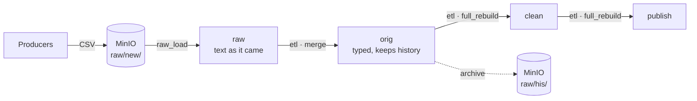

<div align="center">

# Omnis

**A self-hosted data engine: drop raw files in, describe your tables and SQL, and get them loaded, typed and
published on a schedule.**

[](https://airflow.apache.org/)
[](https://www.postgresql.org/)
[](https://min.io/)
[](https://docs.docker.com/compose/)
[](https://www.python.org/)
[](#raspberry-pi)
[](LICENSE)

[What it is](#what-it-is) · [Quickstart](#quickstart) · [Going further](#going-further)

</div>

---

## What it is

Omnis is a small data platform you run on your own machine, from a laptop to a Raspberry Pi. Producers drop CSV
files into a bucket; Omnis loads them into PostgreSQL, types and cleans them with SQL, and publishes tables ready to
query from any SQL client or BI tool, every hour.

It is a **generic engine**: a data flow is a folder of plain files (a task graph, task declarations, table
definitions and SQL queries), and the engine turns it into an Airflow DAG. Adding or changing a flow needs no engine
code.



- **All processing is SQL**, in the warehouse: each transformation is one `SELECT`, written by the engine with a full
  rebuild or a merge by key.
- **Raw files are loaded once**: they are archived only after their data is safely in `orig`.
- **Failures don't go unnoticed**: a failed run e-mails you, and its flow can pause itself until you fix it.
- **Monthly backups** of the warehouse and of the raw files, out of the box.

The repo ships one flow, `health` (gym series, running sessions and muscular fatigue), as a working example.

## Quickstart

You need [Docker](https://docs.docker.com/get-docker/) with Compose v2 and about 4 GB of memory for it.

**1. Clone the repo and create your `.env`** from the template:

```bash
git clone https://github.com/JuanDiegoBarrado/Omnis.git
cd Omnis
cp .env.example .env
```

Edit `.env` and change at least every `change-me`. It is gitignored, so your passwords stay on your machine. Every
variable is described in [Configuration](#configuration).

**2. Start the stack.** The first start builds the images and sets up Airflow, so it takes a few minutes:

```bash
docker compose up -d
```

| Service | URL | Login |
|---|---|---|
| Airflow UI | http://localhost:8080 | `_AIRFLOW_WWW_USER_USERNAME` / `_AIRFLOW_WWW_USER_PASSWORD` |
| MinIO console | http://localhost:9001 | `MINIO_ROOT_USER` / `MINIO_ROOT_PASSWORD` |
| PostgreSQL warehouse | `localhost:5432` | `POSTGRES_USER` / `POSTGRES_PASSWORD`, database `POSTGRES_DB` |

**3. Turn the flow on.** New flows start paused: in the Airflow UI, unpause the `health` DAG. It runs every hour.

**4. Try it.** Save this as `series_gimnasio_20261001120000.csv`:

```csv
fecha,num,ejercicio,peso,reps,rir,rpe
2026-10-01,1,Curl de biceps con mancuerna,12,10,2,8
2026-10-01,2,Curl de biceps con mancuerna,12,9,1,9
```

Upload it in the MinIO console to your data bucket, under `raw/new/series_gimnasio/`. Then trigger `health` in Airflow
(or wait for the next hour) and query the result:

```bash
docker compose exec omnis-database sh -c 'psql -U "$POSTGRES_USER" -d "$POSTGRES_DB" -c "SELECT * FROM publish.series_gimnasio"'
```

The file is now in `raw/his/series_gimnasio/`, so the next run won't load it again.

To stop the stack, `docker compose down`. The warehouse and the bucket are kept in `omnis-database/data/` and
`omnis-storage/minio_storage/`, so nothing is lost.

### Configuration

Everything is set in `.env`; [`.env.example`](.env.example) has every variable with a working default.

| Variable | What it is |
|---|---|
| `POSTGRES_DB`, `POSTGRES_USER`, `POSTGRES_PASSWORD` | The warehouse database and its user. |
| `POSTGRES_HOST_PORT` | Port of the warehouse on the host (`5432`). |
| `AIRFLOW_UID` | User the Airflow containers run as. On Linux, the output of `id -u` (`1000`, the default, for the first user); elsewhere any value. |
| `AIRFLOW_WEB_PORT` | Port of the Airflow UI (`8080`). |
| `_AIRFLOW_WWW_USER_USERNAME`, `_AIRFLOW_WWW_USER_PASSWORD` | Admin user of the Airflow UI, created on the first start. |
| `MINIO_ROOT_USER`, `MINIO_ROOT_PASSWORD` | MinIO's root user (password of 8+ characters), also used by the flows. |
| `MINIO_API_PORT`, `MINIO_WEB_UI_PORT` | Ports of the S3 API (`9000`) and of the MinIO console (`9001`). |
| `MINIO_DATA_BUCKET` | Bucket where producers drop the raw files. Created on start if missing. |
| `ALERT_EMAIL` | Who gets an e-mail when a run or a backup fails. |
| `SMTP_HOST`, `SMTP_PORT`, `SMTP_USER`, `SMTP_PASSWORD` | SMTP server the alerts are sent through, as `SMTP_USER`. |

**Failure e-mails** are optional: they are on only when `ALERT_EMAIL`, `SMTP_HOST`, `SMTP_USER` and `SMTP_PASSWORD`
are all set. Port 465 uses TLS and any other STARTTLS. With Gmail, use `smtp.gmail.com`, port `587` and an
[app password](https://myaccount.google.com/apppasswords), ideally of an account created just for the alerts. Changes
to `.env` apply on the next `docker compose up -d`.

### Raspberry Pi

`docker_compose_modes/` holds the same stack in each mode it can run in:

- `docker-compose.default.yaml`: the same as the root `docker-compose.yaml`.
- `docker-compose.raspberry.yaml`: tuned for a Raspberry Pi 5 shared with other services. Every long-running service
  has a `mem_limit`, logs rotate, both Postgres use a small cache, and Airflow runs with fewer processes and no
  triggerer.

Run a mode from the repo root with `--project-directory .`, so it reads the root `.env` and keeps the same containers
and volumes:

```bash
docker compose --project-directory . -f docker_compose_modes/docker-compose.raspberry.yaml up -d
```

Switching from the default mode leaves the triggerer running: `--remove-orphans` stops it.

Docker only applies the `mem_limit`s if the kernel has the memory cgroup enabled, which Raspberry Pi OS leaves
disabled: if `docker info` warns `No memory limit support`, add `cgroup_enable=memory` to the end of the single line
of `/boot/firmware/cmdline.txt` and reboot. `docker stats` shows what each container uses.

---

## Going further

### Repository layout

```
.
├── docker-compose.yaml        # the stack, with the default resources
├── docker_compose_modes/      # the same stack per mode (default, raspberry)
├── .env.example               # template of .env
├── omnis-airflow/
│   ├── config/                # airflow.cfg, generated on the first start
│   ├── dags/<flow>/           # one folder per flow
│   └── plugins/omnis/         # the engine, with its tests
├── omnis-database/            # warehouse data, its backups and backup script
├── omnis-storage/             # bucket data, its backups, init and backup scripts
└── omnis-backup/              # image of the backup services
```

| Service | What it does |
|---|---|
| `omnis-database` | PostgreSQL 16, the warehouse. The flows create every table they need. |
| `omnis-storage` | MinIO, the landing zone of the raw files. |
| `omnis-storage-init` | Creates the data bucket if it doesn't exist, then exits. |
| `airflow-*` | Airflow 3.1 (LocalExecutor), with its own metadata database. |
| `omnis-database-backup`, `omnis-storage-backup` | Monthly backups (see [Backups](#backups)). |

To run an Airflow CLI command: `docker compose --profile debug run --rm airflow-cli <command>`, e.g. `dags list`.

Airflow is configured in the compose files, with `AIRFLOW__<SECTION>__<KEY>` variables, so every machine runs it the
same way. `omnis-airflow/config/airflow.cfg` is not in the repo: `airflow-init` generates it on the first start, with
random secret keys of its own on every machine. Deleting it and restarting the stack generates new keys.

### Anatomy of a flow

A flow is a folder of `omnis-airflow/dags/`, and its name is the folder's:

```
omnis-airflow/dags/<flow>/
├── <flow>.py                  # entry point: wires the flow and sets its schedule
├── graph.yaml                 # which task runs after which
├── tasks/<task>.yaml          # one declaration per node of the graph
├── tables/<table>.sql         # the flow's tables, as idempotent DDL
└── artifacts/pipes/<pipe>.sql # one SELECT per ETL
```

- **`<flow>.py`** builds the flow and its Airflow DAG: the adapters it runs on (warehouse, bucket, alerts), the task
  types it allows and the Airflow settings (`schedule`, `tags`...). Copy [`health.py`](omnis-airflow/dags/health/health.py)
  and change the flow name. Keep the words "airflow" and "dag" in its docstring: Airflow skips files without them.
- **`graph.yaml`** only says which task precedes which:

  ```yaml
  nodes:
    raw.series_gimnasio:
    orig.series_gimnasio:
      after: [raw.series_gimnasio]
  ```

- **`tasks/<task>.yaml`** declares each node, with a `type` (see [Task types](#task-types)). There is exactly one file
  per node.
- **`tables/<table>.sql`** creates each table a task writes, with `CREATE SCHEMA/TABLE IF NOT EXISTS` (or
  `CREATE OR REPLACE FUNCTION`). Each file creates its own schema, so order doesn't matter. Raw tables have no DDL:
  their raw load creates them.
- **`artifacts/pipes/<pipe>.sql`** is the query of an ETL: one `SELECT`, with its origin tables written literally, no
  templating and no writes. Its output columns must match the destination's. It starts with a header comment saying
  what the table holds and every rule that decides which rows end up in it; it shows in the task's docs in Airflow.

By convention, tasks, pipes and tables are named after the table they produce (`orig.series_gimnasio`), and an archive
is named `archive.<entity>`.

**What happens when you add a flow.** Airflow picks the new folder up within 5 minutes and shows its DAG, paused;
later changes to its files show within 30 seconds (5 minutes in the Raspberry Pi mode). Every run starts with a `create_tables` task that applies all of `tables/`, then
runs one task per node of the graph, in its order. Before any of that, the engine checks the flow: the graph and the
task files must match, every table must have exactly one writer, and every table a task writes must be created once
(by its DDL or by its raw load). A flow that breaks a rule, or a YAML that doesn't validate, shows up in Airflow as a
DAG import error saying why, and never runs. No other code or service changes; new raw files go to
`<data bucket>/raw/new/<entity>/`.

### Task types

**`etl`** writes the rows of a pipe into a table, in one transaction:

```yaml
type: etl
destination: orig.series_gimnasio
pipe: orig.series_gimnasio
strategy: merge          # or full_rebuild (the default)
key: [fecha, num]        # only with merge
pre_statement: ...       # optional SQL, run before writing
post_statement: ...      # optional SQL, run after writing
```

`full_rebuild` replaces the whole table (`DELETE` + `INSERT ... SELECT`); `merge` updates the rows whose key already
exists and inserts the rest (`MERGE`), so the table keeps its history. A merge pipe must not return the same key twice
nor a NULL key (use `DISTINCT ON` and filter NULLs): the engine checks it and fails the task.

**`raw_load`** lands every `.csv` directly under `source` (a prefix of the data bucket) into `destination`:

```yaml
type: raw_load
source: raw/new/series_gimnasio/
destination: raw.series_gimnasio
columns: [fecha, num, ejercicio, peso, reps, rir, rpe]
```

It recreates the destination on every run as a text-only table with the declared columns, and loads the files matching
columns by header (lowercased). A column that isn't declared fails the load. Each row gets the name of its file in an
extra `source_file` column. Typing and cleaning are the job of the ETL after it.

**`archive`** moves the files loaded into a raw table from one prefix to another:

```yaml
type: archive
files_from: raw.series_gimnasio
source: raw/new/series_gimnasio/
destination: raw/his/series_gimnasio/
```

Put it in the graph after the ETL that reads the raw table, so files are archived only once their data is in. A file
that arrived after the raw load stays for the next run.

### The engine

The engine is the `omnis` Python package in [`omnis-airflow/plugins/omnis/`](omnis-airflow/plugins/omnis), with a
hexagonal layout:

- **`domain/`**: the flow, its graph and its tasks, including how each builds its Airflow task.
- **`ports/`**: the interfaces the domain runs on (database, data sources, task types and runners, notifier), and the
  repositories that read a flow's files.
- **`adapters/`**: their implementations (PostgreSQL, local files and S3, YAML and SQL parsers, SMTP e-mails...).

Each `<flow>.py` is the composition root: it builds the adapters and injects them, so different flows, or different
task types within one flow, can run on different engines.

**Adding a task type** takes a `Task` subclass in `domain/tasks/`, its `TaskType` (which validates its YAML) in
`adapters/task_type/`, its runner in `adapters/task_runner/`, and an entry in the `task_types` of each `<flow>.py`
that uses it. No existing code changes.

The Airflow image adds what the engine imports, listed in `omnis-airflow/requirements.txt` (UTF-16 encoded). After
changing it, rebuild with `docker compose build`.

### Failure alerts

When a run of a flow fails, Airflow e-mails `ALERT_EMAIL` with the run and the last task that finished (see
[Configuration](#configuration)). `health` also pauses itself after a failed run
(`max_consecutive_failed_dag_runs=1`), so nothing else runs until you fix the cause and unpause it.

### Tests

The engine's tests live inside the package, in
[`omnis-airflow/plugins/omnis/tests/`](omnis-airflow/plugins/omnis/tests), mirroring `domain/`, `ports/` and
`adapters/`. To run them, create a virtual environment at the repo root:

```bash
python -m venv .venv
.venv/Scripts/pip install "apache-airflow==3.1.0" --constraint "https://raw.githubusercontent.com/apache/airflow/constraints-3.1.0/constraints-3.11.txt"
.venv/Scripts/pip install boto3 psycopg2-binary pytest "testcontainers[postgres,minio]"
.venv/Scripts/python -m pytest
```

(On Linux and macOS, `.venv/bin/` instead of `.venv/Scripts/`; change `3.11` in the constraints URL to your Python
version.)

- Domain and port tests use the in-memory doubles of `tests/fakes.py`.
- Adapters that talk to PostgreSQL or S3 are tested against throwaway containers of the same images as the stack, so
  they need Docker. `-m "not integration"` skips them.
- Test data lives next to each test module, in a folder of its name: each case has `given/` and `expected/` tables as
  `<schema>.<table>.csv`.
- Every test starts with a docstring saying what it checks and, if it fails, what is broken and why it matters.

### Backups

`omnis-database-backup` and `omnis-storage-backup` copy the warehouse (`pg_dump`) and the data bucket (`mc mirror`)
once a month, into `omnis-database/backups/<YYYYMMDDHHMMSS>/` and `omnis-storage/backups/<YYYYMMDDHHMMSS>/` (UTC).
Both run on the image of `omnis-backup/`. Every hour they check whether this month already has a copy, so they make it
at the start of the month, or as soon as the stack starts if it was down then. Old copies are never deleted.

A failed copy is left in `<YYYYMMDDHHMMSS>.failed/`, with its `error.log`, and e-mailed to `ALERT_EMAIL` if the
`SMTP_*` variables are set, as the failed runs of Airflow are. It is not retried: once the cause is fixed, delete that
folder and the copy runs again within the hour.

To restore one, with the stack running (`<copy>` is the folder name):

```bash
docker compose exec omnis-database-backup sh -c 'pg_restore --clean --if-exists -d "$PGDATABASE" /backups/<copy>/"$PGDATABASE".dump'
docker compose exec omnis-storage-backup sh -c 'mc mirror --overwrite /backups/<copy>/"$MINIO_DATA_BUCKET" local/"$MINIO_DATA_BUCKET"'
```

## License

Omnis is released under the [MIT License](LICENSE).

---

<sub>This README was written by Claude Opus 5.5 (Claude Code) and reviewed by Juan Diego Barrado Daganzo.</sub>
